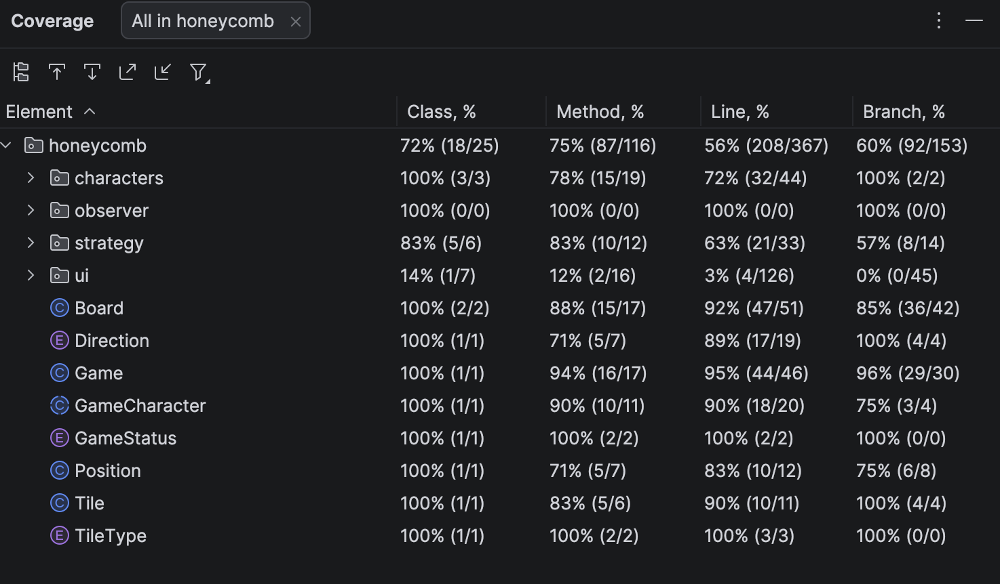

# Honeycomb


## About the project

Honeycomb is a maze exploration game we're building in Java using Swing.

The idea starts with a bee whose hive has lost a lot of its honey after a bear raids it. She heads out into a magical garden to find resources and help her hive recover. Along the way, she has to explore unfamiliar paths, deal with creatures, and figure out how to make the most of what she finds.

We wanted the game to feel cozy, but still give the player challenges to think through. Rather than just moving through a maze and collecting items, the player has to think about where to go, which pollen to go after first, and how to stay out of the creatures' way.

## What the game does

- The bee explores a garden maze of open paths and walls, and the player decides which paths to take.
- Pollen is scattered around the garden, and the bee collects it by landing on it.
= Two kinds of creatures share the garden: hornets, which hunt the bee, and wasps, which wander randomly.
- The player wins by collecting all the pollen and loses if a creature catches the bee.
- The player can restart the same round or generate a new garden.
- The bee moves with the arrow keys or the on-screen direction buttons.

## Test Coverage Screenshot



## Why we're making it

One of the things we find interesting about bees is how much their lives depend on their community. Honeycomb was an opportunity to explore that idea through a game, while also creating something that is fun to play and has room for strategy and discovery.

We also used the project to get more experience designing an object-oriented program, writing tests, and building a graphical application in Java. We wanted the different parts of the game to work together in a way that makes sense, rather than adding features just for the sake of adding them.

## Technologies

- Java
- Java Swing
- Maven for building and managing dependencies
- JUnit for testing
- Cucumber and Gherkin for behavior-driven (BDD) tests

## Where we are now

The game logic, tests, and Swing interface are in place. You can play through a garden, restart the same round, or generate a new garden. We currently have 75% method coverage requirement. 

## Running the project

You'll need JDK 25. Maven is bundled with IntelliJ, so there's nothing extra to install.

- **In IntelliJ:** open the Maven tool window and run **Lifecycle → test**.
- **From a terminal (if Maven is installed):** `mvn clean test`
- **To play in IntelliJ:** open `src/main/java/honeycomb/ui/HoneycombApp.java` and click the green run button next to `main()`. Use the arrow keys or the buttons to move the bee.

This runs all the JUnit tests and Cucumber scenarios. The Cucumber HTML report is written to `bdd/report.html`.

## Project structure
- **`honeycomb`**: the game loop, the maze, and shared building blocks (`Game`, `Board`, `Tile`, `TileType`, `Position`, `Direction`, `GameStatus`, `GameCharacter`)
- **`honeycomb.characters`**: the characters and how they're created (`Bee`, `Enemy`, `CharacterFactory`)
- **`honeycomb.strategy`**: how characters decide where to move (`MovementStrategy`, `BeeStrategy`, `HornetStrategy`, `WaspStrategy`, `FrightenedStrategy`, `StrategyFactory`)
- **`honeycomb.observer`**: the observer interface the game uses to announce finished turns (`GameObserver`)
- **`honeycomb.ui`**: the Swing interface and move command (`HoneycombApp`, `HoneycombPanel`, `MoveCommand`, `GardenFactory`)

## Design patterns

### 1. Builder: `Board.Builder`

**Where:** Building the garden maze. This is the same idea as the Maze Builder we used in Polymorphia: `Board` plays the role of the maze, and each `Tile` is like a room.

**How:** `Board`'s constructor is private, so the only way to make a board is through `Board.getNewBuilder()`, which returns a nested `Builder`. The builder lays out the maze step by step and returns a finished `Board` from `build()`:

```java
Board board = Board.getNewBuilder()
        .createGrid(7, 7)
        .createBorderWalls()
        .createWall(3, 3)
        .addPollen(1, 2)
        .addPollen(5, 4)
        .build();
```

The builder also enforces the rules of a valid maze. It throws an exception if something is placed off the board, if pollen is put on a wall, or if `build()` is called before a grid exists.

**Why:** A maze has many parts that have to be set up in the right order. The builder keeps level creation readable, keeps the validation in one place, and guarantees nobody can end up with a half-built board. As we add new resources and hidden paths, they become new builder methods rather than changes scattered across the code.

### 2. Strategy: `MovementStrategy`

**Where:** Deciding how each character moves.

**How:** `MovementStrategy` is an interface with one method, `chooseMove(current, target, board)`, which returns the `Direction` to move. Every `GameCharacter` holds a strategy and hands the decision off to it in `takeTurn()`:
- **`BeeStrategy`** (the bee): moves to the tile the player chose, unless it's a wall.
- **`HornetStrategy`** (hornets): moves to the open tile closest to the bee.
- **`WaspStrategy`** (wasps): picks a random open tile.
- **`FrightenedStrategy`** (all creatures while frightened, for our planned royal jelly ability): moves to the open tile farthest from the bee.

Strategies can be swapped while the game is running. `Game.frightenEnemies()` gives every creature a `FrightenedStrategy`, and `calmEnemies()` puts each one back to its original behavior.

**Why:** Without this, `GameCharacter` would need an `if/else` for every kind of creature and every mode. With it, a new behavior means writing one new strategy class and one `StrategyFactory` method, and nothing else has to change (the Open/Closed Principle). This matters for us because we expect to add friendly characters and new creature types later.

### 3. Factory: `CharacterFactory`

**Where:** Creating characters and the strategies they use. This follows the `CharacterFactory` structure from Polymorphia.

**How:** `CharacterFactory` has creation methods for each character type: `createBee(...)`, several `createHornet(...)` and `createWasp(...)` overloads, and `createHornets(n)` / `createWasps(n)` for groups. Creatures that aren't given a name get a random one from that type's name list. Every method returns a `GameCharacter`, so the rest of the game works with the abstraction instead of the specific class. The factory gets each character's strategy from a `StrategyFactory`, which is passed into its constructor.

`GardenFactory` builds on both of these to create a complete round. It uses the Builder to generate a random maze (walls only where both coordinates are odd, so every even row and column stays connected), places four flowers on shuffled open tiles, and uses `CharacterFactory` to create the bee, the hornet, and the wasp.

**Why:** The rest of the code just asks for "a hornet" without needing to know how one is put together. The factories are the only place that knows a hornet chases and a wasp wanders, so changing a character's behavior means changing one line.

### 4. Command: `MoveCommand`

**Where:** Moving the bee with the buttons and arrow keys.

**How:** `HoneycombPanel` creates one `MoveCommand` for each direction and attaches the same command to a button and an arrow key. `MoveCommand` extends Swing's `AbstractAction`. Each command holds the game and the direction to move, and its `actionPerformed()` calls `game.playTurn(direction)`. Clicking the RIGHT button and pressing the right arrow both run the same command, which calls `game.playTurn(Direction.RIGHT)`.

**Why:** We can handle both ways of moving the bee in one place. When the game ends, disabling a command turns off both the button and the arrow key for that direction.

### 5. Observer: `GameObserver`

**Where:** Updating the Swing panel after a turn.

**How:** `HoneycombPanel` implements `GameObserver`, which is an interface with one method `onTurnFinished(Game game)`. When a round starts, `HoneycombApp` registers the panel with `game.addObserver(panel)`. After the turn finishes, `Game` calls `onTurnFinished()` on its observers. The panel then reads the updated game state and redraws the garden.

**Why:** The game handles movement, pollen, and collisions, and the panel handles how they look on screen. This also lets us test the winning update by registering an observer that records the game status.

### How the patterns work together

The **Builder** creates the maze. The **Character Factory** creates the characters and, through the `StrategyFactory`, gives each one the right **Strategy**. `Game` receives the finished board and characters. When the player clicks a direction button or presses the matching arrow key, the same **MoveCommand** calls `Game.playTurn()` for that direction. Once the turn is finished, `Game` notifies the Swing panel through the **Observer** pattern so it can show the updated positions, pollen, and game status.
## OO principles

### Coding to abstractions

- `Game` stores the bee and the creatures as `GameCharacter`, never as `Bee` or `Enemy`.
- `CharacterFactory` returns `GameCharacter`, and `StrategyFactory` returns `MovementStrategy`.
- `GameCharacter` depends only on the `MovementStrategy` interface, not on any specific strategy.
- `Game` notifies observers through the `GameObserver` interface, so it never depends on the Swing panel directly.

### Polymorphism

1. **`Strategies`.** `Game` calls `takeTurn()` the same way on every character, but each one moves differently depending on which strategy it holds. The same creature also behaves differently before and after `frightenEnemies()`.
2. **`onArrive()`.** `GameCharacter.moveTo()` always calls the abstract method `onArrive(tile)` after a move. A `Bee` collects pollen there, while an `Enemy` does nothing. `GameCharacter` never checks which kind it is.
3. **`Observers`**. Game only knows it has a list of `GameObserver`s and calls `onTurnFinished()` on each one. It doesn't know one of them is a Swing panel; a test can register a different observer and the game treats it the same way.
4. **`Commands`**. Swing's JButton and key bindings only know they hold an Action. When triggered, they call `actionPerformed()`, and our `MoveCommand` supplies what that does.

### Dependency injection

- Each `GameCharacter` receives its `MovementStrategy` through its constructor.
- `CharacterFactory` receives its `StrategyFactory` through its constructor.
- `StrategyFactory` can receive a `java.util.Random`, so tests can pass in a seeded `Random` and get the same results every run.
- `Game` receives its `Board`, bee, creatures, and `StrategyFactory` instead of creating them itself.
- `MoveCommand` receives the `Game` it controls and its `Direction` through its constructor, and `HoneycombPanel` receives the round it displays.
= `GardenFactory` shows these working together: it creates one seeded Random, injects it into the `StrategyFactory`, and injects that into the `CharacterFactory`. Because the maze, the flower spots, and the wasp's movement all come from the same seeded `Random`, Restart replays the exact same garden.

## How a turn works

`Game.playTurn(direction)` runs one turn:

1. If the game is already won or lost, do nothing.
2. Move the bee toward the tile the player chose.
3. Check for a win or loss. Getting caught is checked before winning, so being caught beats grabbing the last pollen.
4. Move every creature, each using its own strategy.
5. Check again, in case a creature moved onto the bee.

The player wins when no pollen is left on the board.

## Tests

### JUnit (`src/test/java/honeycomb/`)

- **`BoardTest`** (8 tests): the Builder, including open grids, border walls, single walls, pollen counting, off-board checks, and rejecting invalid mazes.
- **`BeeTest`** (5 tests): collecting pollen, landing on empty tiles, walls, board edges, and not jumping more than one tile.
- **`GameTest`** (6 tests): winning, losing to a hornet, walls blocking the bee, creatures not collecting pollen, frightening and calming creatures, and rejecting invalid starting positions.
- **`CharacterFactoryTest`** (2 tests): each character gets the right class and strategy, and group creation returns the right count and names.
- **`MoveCommandTest`**(1 test):  clicking a botton attached to a `MoveCommand` plays a turn and moves the bee in that direction

### Cucumber (`src/test/resources/features/movement.feature`)

Four scenarios describe the bee's movement from the player's point of view: moving onto an open path, being blocked by a wall, staying inside the board, and collecting pollen. The step definitions are in `src/test/java/bddtests/MovementSteps.java`.

## Ideas for the future

If we kept building Honeycomb, there are more ways we'd like to make the garden feel alive:

- Royal jelly that frightens the creatures for a few turns, using the frightened mode that's already built in.
- Returning to the hive as the final goal, instead of only collecting all the pollen.
- Abilities that help the bee get around obstacles or outsmart creatures.
- Trading resources with other characters, meeting friends who can help along the way, solving riddles, discovering hidden paths, and learning new abilities from magical flowers.

We also like the idea of community being part of the gameplay. The bee starts out trying to help her own hive, but she might discover that helping others and making connections can make the journey easier, too.
